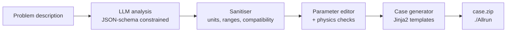

# CFD Case Generator

[](../../actions/workflows/tests.yml)

Describe a fluid-dynamics problem in plain English and get a complete, **ready-to-run
OpenFOAM case**: mesh, boundary conditions, fluid properties, turbulence model, numerical
schemes, solver settings and run scripts.

```
"Steady airflow around a 2-D cylinder at Re = 200, freestream 1 m/s, air at standard conditions."
        │
        ▼
simpleFoam case · 12-block O-grid around the cylinder · kOmegaSST · inlet/outlet/symmetry BCs
→ unzip, ./Allrun
```

An LLM (Claude via the API, or a local model through Ollama) interprets the description;
a deterministic, tested generator turns that interpretation into OpenFOAM files. Every
supported solver × geometry combination is **run in OpenFOAM as part of the test suite**.

---

## How it works



1. **Structured analysis.** The model must answer with an object matching
   [`app/schema.py`](app/schema.py), enforced by structured outputs (`output_config.format`
   for Claude, `format` for Ollama). The response is never free-form text that needs parsing.
2. **Sanitising.** [`app/sanitize.py`](app/sanitize.py) checks what a schema cannot:
   - viscosities in the wrong units, implausible temperatures or speeds
   - solver/geometry combinations that cannot work
   - geometry that does not fit in its domain

   It repairs each problem and shows the user every correction.
3. **Review.** The UI shows the analysis and runs physics checks: Reynolds and Mach regime,
   y⁺ and wall treatment, CFL, and mesh resolution. Inlet speed, viscosity, turbulence model,
   mesh resolution and core count can all be overridden.
4. **Generation.** Solver-specific generators in [`app/generators/`](app/generators) compute
   derived quantities, then render the templates in [`templates/`](templates). Derived
   quantities include turbulence inlet values, wall-graded block meshes (growth rate capped at
   1.2), time steps from wave or Courant limits, and the hierarchical decomposition for
   parallel runs.

## Supported cases

Target: **OpenFOAM v1912** (ESI, openfoam.com), including the Debian/Ubuntu `openfoam` package.

| Solver | Physics | Geometries |
|---|---|---|
| `simpleFoam` | Steady incompressible | channel, T-junction, rectangular obstacle, backward-facing step, cylinder (O-grid), pipe (axisymmetric wedge), airfoil (C/H-grid), STL import (snappyHexMesh) |
| `pimpleFoam` | Transient incompressible | same as simpleFoam |
| `rhoSimpleFoam` | Steady compressible (Ma > 0.3) | same as simpleFoam |
| `buoyantSimpleFoam` | Steady natural convection | differentially heated cavity |
| `interFoam` | Two-phase free surface (VOF) | dam break |

Turbulence models: `kEpsilon`, `kOmegaSST`, `SpalartAllmaras` (interFoam is laminar).

### Verified in OpenFOAM

`tests/test_openfoam_integration.py` generates each case below and runs its own `Allrun`
script. It checks that `blockMesh` / `snappyHexMesh` succeed, `checkMesh` reports
*Mesh OK*, no faces are left unassigned, and the solver runs and exits without NaNs.

| | channel/cavity/dambreak | t_junction | rect. obstacle | backstep | cylinder | pipe | airfoil | STL |
|---|:-:|:-:|:-:|:-:|:-:|:-:|:-:|:-:|
| simpleFoam (3 turbulence models) | ✅ | ✅ | ✅ | ✅ | ✅ | ✅ | ✅ | ✅ |
| pimpleFoam (3 turbulence models) | ✅ | ✅ | ✅ | ✅ | ✅ | ✅ | ✅ | |
| rhoSimpleFoam (3 turbulence models) | ✅ | ✅ | ✅ | ✅ | ✅ | ✅ | ✅ | |
| buoyantSimpleFoam (3 turbulence models) | ✅ | | | | | | | |
| interFoam | ✅ | | | | | | | |
| parallel run (decomposePar → mpirun → reconstructPar) | ✅ | | | | | | | |

These are short smoke runs (30 iterations or 15 time steps). They show that a case meshes,
starts and stays numerically stable. They are not a validation of converged results against
reference data.

---

## Quick start

```bash
git clone <this repo> && cd cfd-case-generator
python -m venv .venv && source .venv/bin/activate
pip install -r requirements.txt
streamlit run app/main.py            # opens http://localhost:8501
```

### LLM backend

**Claude (recommended).** Get an API key at [console.anthropic.com](https://console.anthropic.com),
then either `export ANTHROPIC_API_KEY=sk-ant-...` or paste it in the sidebar. The default
model is `claude-opus-5-5`. Pick another in the sidebar, or set `CFD_CLAUDE_MODEL`.
If the default model declines a request, it is retried server-side on a fallback model.

**Ollama (local, free).** Install [Ollama](https://ollama.com) ≥ 0.5, then run
`ollama pull mistral` and `ollama serve`, and select *Ollama* in the sidebar. Models of 7B
parameters or more give noticeably better analyses. `llama3`, `qwen2.5` and `phi4` work well.

### Running a generated case

```bash
source /usr/share/openfoam/etc/bashrc     # or your OpenFOAM installation's etc/bashrc
unzip simpleFoam_case.zip && cd simpleFoam
./Allrun                                  # writes log.blockMesh, log.simpleFoam, …
paraview case.foam                        # after: touch case.foam
./Allclean
```

Paste `log.<solver>` into the app's **Convergence Monitor** to plot the residuals.

### Example descriptions

```
Steady-state airflow around a 2D cylinder at Re=200 with a freestream velocity of 1 m/s.
The fluid is air at standard conditions. Domain 20 diameters long and 10 wide.
```
```
Unsteady incompressible flow past a bluff body at Re=1000. Water at 0.5 m/s.
I need to capture vortex shedding.
```
```
Natural convection in a square cavity with the hot left wall at 350 K and the cold
right wall at 300 K. The fluid is air. Steady state.
```
```
Transonic flow over a NACA 0012 airfoil at Mach 0.8, chord 1 m, 300 K, 1 atm.
```
```
Dam-break: water column 0.3 m high and 0.1 m wide collapsing into a dry 1 m basin.
```

---

## Testing

```bash
pip install -r requirements-dev.txt
pytest -m "not openfoam"                  # unit, regression and headless UI tests (~20 s)

source /usr/share/openfoam/etc/bashrc
pytest -m openfoam -v                     # run every generated case in OpenFOAM (~2–3 min)
```

| Suite | What it covers |
|---|---|
| `test_generators.py` | File trees, template rendering, grading maths, every geometry |
| `test_regressions.py` | One test per OpenFOAM bug found by the end-to-end runs; works without OpenFOAM |
| `test_sanitize.py` | Repairing implausible or inconsistent LLM output |
| `test_llm.py` | Structured-output requests, fallbacks, refusals, Ollama (all mocked) |
| `test_ui.py` | Streamlit app driven headlessly: analyse → edit → generate → zip |
| `test_openfoam_integration.py` | 33 generated cases meshed and run in OpenFOAM |

CI ([`.github/workflows/tests.yml`](.github/workflows/tests.yml)) runs the unit suite on
Python 3.10 and 3.12, and the OpenFOAM suite on Ubuntu with the distribution's `openfoam` package.

## Project structure

```
app/
├── main.py                 # Streamlit entry point (composes app/ui/*)
├── ui/                     # sidebar, problem input, analysis view, parameter editor,
│                           # physics checks, case output, convergence monitor
├── llm.py                  # Claude + Ollama backends (structured outputs)
├── schema.py               # JSON schema the LLM must follow
├── sanitize.py             # unit / range / compatibility repair of the analysis
├── editor.py               # parameter-editor overrides → analysis
├── validation.py           # physics checks (Re, Ma, y+, CFL, resolution)
├── generators/             # one generator per solver + shared base (meshing maths)
├── log_parser.py           # residual extraction from solver logs
├── stl_parser.py           # STL bounding box for snappyHexMesh background meshes
└── geometry_sketches.py    # ASCII sketches shown in the sidebar
templates/
├── <solver>/               # 0/, constant/, system/ Jinja2 templates per solver
├── geometries/<name>/      # blockMeshDict per geometry
├── _macros/                # boundary-condition macros shared by all field files
└── _shared/                # Allrun/Allclean, decomposeParDict, snappyHexMesh, sampling
tests/
```

## Known limitations

- **OpenFOAM flavour.** Templates target ESI OpenFOAM (v1912+). OpenFOAM.org (v10+ uses
  `physicalProperties`, different solver names) is not supported.
- **Results are a starting point.** Meshes are coarse 2-D (one cell thick) or axisymmetric.
  For production use, check mesh independence and y⁺, and validate against reference data.
- **Turbulence modelling.** RANS only (`kEpsilon`, `kOmegaSST`, `SpalartAllmaras`) with
  wall functions; no LES/DES and no low-Re wall resolution.
- **Boundary conditions.** Uniform inflow, zero-gradient / fixed-pressure outlets and
  no-slip walls. Turbulent inflow profiles and mapped BCs are not generated.
- **Airfoil geometry.** The airfoil is a rectangular-section body of the requested chord and
  thickness, not a true NACA profile. Upload an STL for an exact shape.
- **Radiation** is off in `buoyantSimpleFoam` (`radiationProperties` → `none`).

## License

[MIT](LICENSE)
