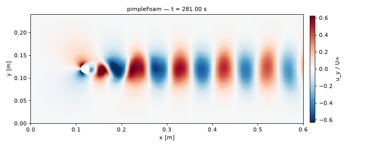
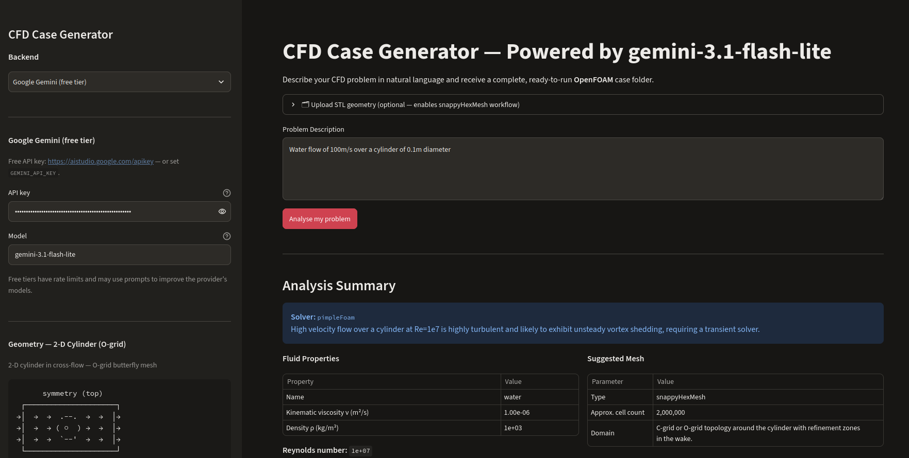
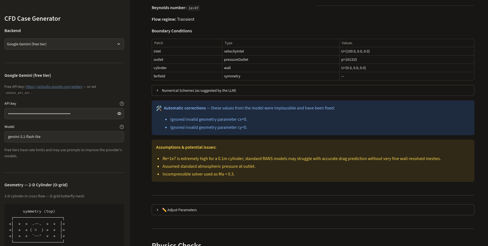
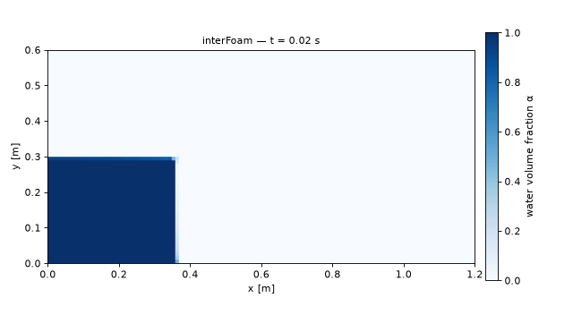
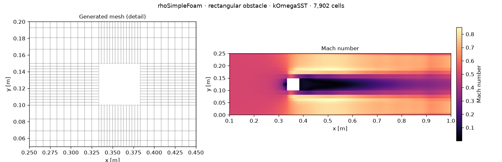
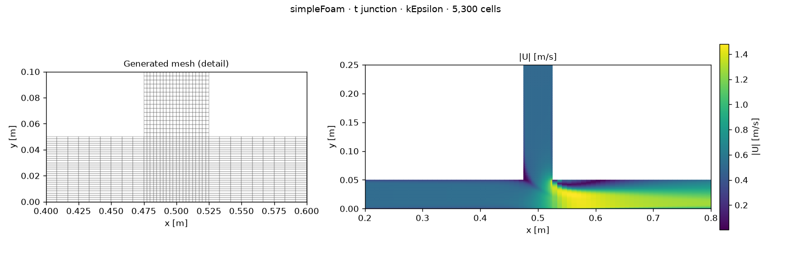
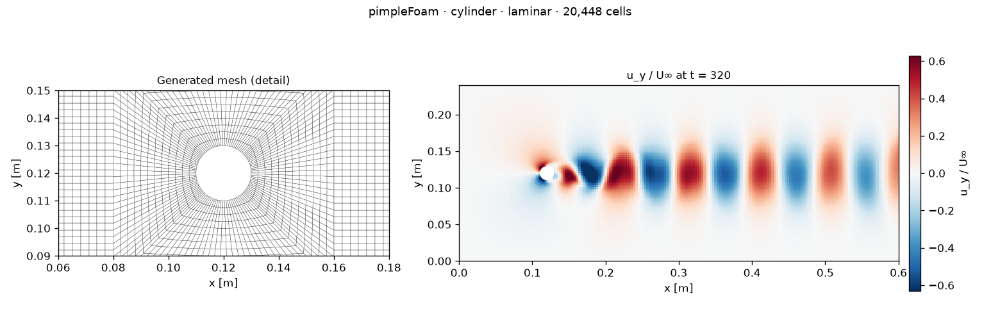
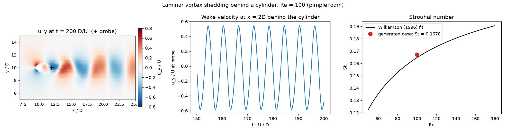
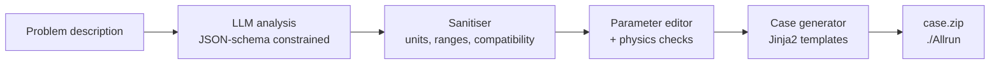

# CFD Case Generator

[](../../actions/workflows/tests.yml)

Describe a fluid-dynamics problem in plain English and get a complete, **ready-to-run
OpenFOAM case**: mesh, boundary conditions, fluid properties, turbulence model, numerical
schemes, solver settings and run scripts. The cases are **run and checked against reference
data** as part of the test suite.

<p align="center">
  <br>
  <em>"Laminar flow of water past a 2 cm circular cylinder at 7.5 mm/s (Re = 150). I want to see
  the von Kármán vortex street…" → pimpleFoam case, O-grid mesh, run with <code>./Allrun</code></em>
</p>

## What it can do

- **Understand a problem description.** An LLM (Claude, free cloud models such as Gemini or
  Groq, or a local model through Ollama) picks the solver, fluid properties, boundary conditions, turbulence model and
  geometry. A JSON schema constrains its answer, and every value is sanity-checked:
  implausible numbers are corrected and shown to the user.
- **Generate complete OpenFOAM cases**:
  - **5 solvers:** steady and transient incompressible, compressible, natural convection,
    two-phase free surface
  - **9 meshed geometries,** plus your own STL through snappyHexMesh
  - **laminar flow or 3 RANS models**
  - wall-graded multi-block meshes, serial or parallel runs, `Allrun`/`Allclean`, sampling
    dictionaries and a README
- **Check the physics before you run:** Reynolds and Mach regime, y⁺ and wall treatment,
  Courant number, mesh resolution. Adjust speed, viscosity, model, mesh and cores in the UI.
- **Run and post-process:** `cfdgen … --run` meshes and solves the case. The convergence
  monitor plots residuals from any OpenFOAM log, and `app/postprocess` reads meshes and fields
  in pure Python, independent of OpenFOAM's function objects.
- **Prove the results are right:** validation benchmarks compare generated cases with
  analytical solutions and published data, from laminar profiles to heat transfer and
  unsteady vortex shedding (all within 1.5 %, see below).

## The web app

<p align="center"></p>

<details>
<summary><b>More screenshots</b>: boundary conditions and automatic corrections, physics checks</summary>
<p align="center">
  <br><br>
  
</p>
</details>

## Gallery

Each image comes from a case produced by the generator from the input below, run with its
own `Allrun`, and drawn cell by cell from the OpenFOAM results
([`scripts/make_gallery.py`](scripts/make_gallery.py)). The inputs are in [`examples/`](examples).

| | |
|:-:|:-:|
| <br>**Dam break**, interFoam (VOF)<br><sub>"A column of water 0.36 m wide and 0.3 m high collapses under gravity into a dry tank 1.2 m long…"</sub> | <br>**Backward-facing step**, simpleFoam + k-ω SST<br><sub>"Turbulent air flow at 10 m/s over a backward-facing step 10 cm high…" (black line: u = 0, edge of the recirculation zone)</sub> |
| <br>**Mach 0.5 flow past a block**, rhoSimpleFoam + k-ω SST<br><sub>"Compressible air flow at 170 m/s (Mach 0.5), 300 K and 1 atm, past a 5 cm square block…" Flow accelerates to Ma ≈ 0.85 beside the block. Steady RANS snapshot: the bluff-body wake is physically unsteady, so residuals plateau.</sub> | <br>**T-junction**, simpleFoam + k-ε<br><sub>"Water at 0.5 m/s flows along a 5 cm high channel and meets a side branch…" The merged stream doubles in speed; a separation bubble forms at the downstream corner.</sub> |

<p align="center"><br>
<sub><b>Cylinder at Re = 150</b>, pimpleFoam (laminar): generated O-grid mesh and the cross-stream velocity of the vortex street</sub></p>

## Validation

[`validation/`](validation) generates each benchmark through the same code path as the app,
runs it in OpenFOAM and compares it with the reference. Full report with plots:
[`docs/validation/results.md`](docs/validation/results.md).

| Benchmark | Quantity | Reference | Error |
|---|---|---|---:|
| Plane Poiseuille flow, Re = 100 | centreline velocity, pressure gradient, profile | analytical | ≤ 0.14 % |
| Hagen–Poiseuille pipe (axisymmetric), Re = 100 | centreline velocity, pressure gradient, profile | analytical | ≤ 0.18 % |
| Natural convection cavity, Ra = 10⁵ | Nusselt number, u_max, v_max | de Vahl Davis (1983) | ≤ 0.33 % |
| Vortex shedding behind a cylinder, Re = 100 | Strouhal number (shedding frequency) | Williamson (1996) | +1.4 % ¹ |

¹ Expected to be slightly high: the symmetry planes 10 D from the cylinder (5 % blockage)
speed up the shedding compared with the unbounded reference.

<p align="center"></p>
<p align="center"></p>

```bash
source /usr/share/openfoam/etc/bashrc
python -m validation.run          # ≈ 12 min on 6 cores; writes docs/validation/
```

## LLM evaluation

How often does a model turn a description into the *right* CFD setup? [`evals/`](evals) scores
answers on 20 descriptions with known answers: solver, geometry, laminar vs RANS, steady vs
transient, the Reynolds number actually simulated (U·L/ν within 15 %) and the fluid. Each
answer is scored raw and after the sanitiser, i.e. what the app actually generates. Full
results: [`docs/evaluation/results.md`](docs/evaluation/results.md).

Fully correct answers (all checked fields right):

| Model | Held-out: raw | **Held-out: after sanitiser** | Dev set: after sanitiser | Time per answer |
|---|---:|---:|---:|---:|
| `gemini-3.1-flash-lite` (free cloud tier) | 100 % | **100 %** | 100 % | 3 s |
| `qwen2.5:7b` (local) | 40 % | **80 %** | 80 % | 65 s |
| `mistral` 7B (local) | 40 % | **60 %** | 70 % | 83 s |
| `llama3.1:8b` (local) | 20 % | **40 %** | 60 % | 65 s |

The **held-out** cases (10) were written after the sanitiser rules were developed and
[committed before any model saw them](evals/cases_holdout.json), so they give the unbiased
numbers. The 20 **development** cases are the ones that exposed systematic mistakes the
sanitiser now repairs: laminar flow at Re = 13 million, turbulence models at Re = 40, an
incompressible solver at Mach 0.73, 0.82 m/s for "Mach 0.8", and the sanitiser itself breaking
correct geometries when the solver was wrong.

Takeaways: a free cloud model gets every case right. For local 7–8B models, the sanitiser
roughly doubles the share of correct setups, and the gains carry over to unseen
descriptions (qwen: 40 % → 80 % on the held-out set).

```bash
python -m evals.run --backend ollama --model qwen2.5:7b          # or --backend gemini …
python -m evals.run --report                                      # re-score cached answers
```

## Run-and-fix agent

`cfdgen generate … --fix gemini` (or `cfdgen fix CASE_DIR --backend gemini`) runs the case.
If it fails, the agent diagnoses the failure from the OpenFOAM logs and repairs it in two
layers, then reruns:

1. **Rules** for failures with a known fix: a missing `…Final` or `pcorr` solver entry, a
   missing divergence scheme, divergence (stronger under-relaxation with α_p ≈ 1 − α_U,
   pressure limits, or a smaller Courant number).
2. **An LLM** for the rest: it gets the error, the end of the log and the relevant
   dictionaries, and returns one corrected file.

**Safety rails:** the LLM may only rewrite existing dictionaries in `system/`, `constant/`
and `0/` (never `Allrun` or the mesh). Edits containing code-execution directives
(`#codeStream`, `coded…` conditions, `systemCall`) are rejected, and so is a "fix" that
shortens the run. Every attempt is logged with a diff in `agent_report.md`.

**Fault-injection benchmark** ([`evals/faults.py`](evals/faults.py), full table in
[`docs/evaluation/agent_results.md`](docs/evaluation/agent_results.md)): 10 realistic faults,
mostly bugs this project actually had, are injected into working cases.

| Repair mode | Faults repaired |
|---|---:|
| Rules only | 6 / 10 |
| Rules + `qwen2.5:7b` (local) | 8 / 10 ¹ |
| **Rules + `gemini-3.1-flash-lite`** | **10 / 10** |

¹ 7/10 before the agent learned to map near-miss paths (e.g. `0/fvSchemes` → `system/fvSchemes`)
onto the files the model was shown; qwen often had the right diagnosis but the wrong path.

---

## How it works



1. **Structured analysis.** The model must answer with an object matching
   [`app/schema.py`](app/schema.py), enforced by structured outputs (`output_config.format`
   for Claude, `format` for Ollama). The response is never free-form text that needs parsing.
2. **Sanitising.** [`app/sanitize.py`](app/sanitize.py) checks what a schema cannot:
   - viscosities in the wrong units, implausible temperatures or speeds
   - solver/geometry combinations that cannot work
   - geometry that does not fit in its domain
   - inlet velocities that do not point into the domain
   - a Reynolds number that disagrees with U·L/ν: a value stated in your description wins
     and the velocity is rescaled, otherwise Re is recomputed from the velocity
   - a steady solver for a bluff body above the vortex-shedding threshold (switched to the
     transient pimpleFoam)

   These were added after testing local models: for "Laminar flow past a cylinder at
   Re = 100", both `mistral` and `qwen2.5:7b` returned inputs giving Re ≈ 6 700–67 000 and
   a steady solver. The sanitiser now repairs both answers to a correct Re = 100 transient case.

   It repairs each problem and shows the user every correction.
3. **Review.** The UI shows the analysis and runs physics checks: Reynolds and Mach regime,
   y⁺ and wall treatment, CFL, and mesh resolution. Inlet speed, viscosity, turbulence model,
   mesh resolution and core count can all be overridden.
4. **Generation.** Solver-specific generators in [`app/generators/`](app/generators) compute
   derived quantities, then render the templates in [`templates/`](templates). Derived
   quantities include turbulence inlet values, wall-graded block meshes (growth rate capped at
   1.2), time steps from wave or Courant limits, and the hierarchical decomposition for
   parallel runs.

## Supported cases

Target: **OpenFOAM v1912** (ESI, openfoam.com), including the Debian/Ubuntu `openfoam` package.

| Solver | Physics | Geometries |
|---|---|---|
| `simpleFoam` | Steady incompressible | channel, T-junction, rectangular obstacle, backward-facing step, cylinder (O-grid), pipe (axisymmetric wedge), airfoil (C/H-grid), STL import (snappyHexMesh) |
| `pimpleFoam` | Transient incompressible | same as simpleFoam |
| `rhoSimpleFoam` | Steady compressible (Ma > 0.3) | same as simpleFoam |
| `buoyantSimpleFoam` | Steady natural convection | differentially heated cavity |
| `interFoam` | Two-phase free surface (VOF) | dam break |

Flow models: `laminar`, or RANS with `kEpsilon`, `kOmegaSST`, `SpalartAllmaras` (interFoam is laminar).

### Verified in OpenFOAM

`tests/test_openfoam_integration.py` generates each case below and runs its own `Allrun`
script. It checks that `blockMesh` / `snappyHexMesh` succeed, `checkMesh` reports
*Mesh OK*, no faces are left unassigned, and the solver runs and exits without NaNs.

| | channel/cavity/dambreak | t_junction | rect. obstacle | backstep | cylinder | pipe | airfoil | STL |
|---|:-:|:-:|:-:|:-:|:-:|:-:|:-:|:-:|
| simpleFoam (laminar + 3 RANS models) | ✅ | ✅ | ✅ | ✅ | ✅ | ✅ | ✅ | ✅ |
| pimpleFoam (laminar + 3 RANS models) | ✅ | ✅ | ✅ | ✅ | ✅ | ✅ | ✅ | |
| rhoSimpleFoam (laminar + 3 RANS models) | ✅ | ✅ | ✅ | ✅ | ✅ | ✅ | ✅ | |
| buoyantSimpleFoam (laminar + 3 RANS models) | ✅ | | | | | | | |
| interFoam | ✅ | | | | | | | |
| parallel run (decomposePar → mpirun → reconstructPar) | ✅ | | | | | | | |

These are short smoke runs (30 iterations or 15 time steps). They show that a case meshes,
starts and stays numerically stable. Accuracy is checked separately by the
[validation benchmarks](#validation), which run to convergence.

---

## Quick start

```bash
git clone <this repo> && cd cfd-case-generator
python -m venv .venv && source .venv/bin/activate
pip install -r requirements.txt && pip install -e .
streamlit run app/main.py            # web UI at http://localhost:8501
```

### Command line

```bash
# Plain English → case (LLM), then mesh and solve it
cfdgen describe "Laminar flow past a 2-D cylinder at Re = 100" -o cylinder/ --run

# From an analysis JSON, no LLM or API key needed (see examples/)
cfdgen generate examples/dam_break.json -o dambreak/ --run

# Physics checks only
cfdgen check examples/backward_facing_step.json
```

### LLM backend

**Claude (recommended).** Get an API key at [console.anthropic.com](https://console.anthropic.com),
then either `export ANTHROPIC_API_KEY=sk-ant-...` or paste it in the sidebar. The default
model is `claude-opus-5-5`. Pick another in the sidebar, or set `CFD_CLAUDE_MODEL`.
If the default model declines a request, it is retried server-side on a fallback model.

**Free cloud models (Gemini, Groq, OpenRouter).** These run much larger models than fit on a
laptop, on free tiers with rate limits. Create a free key, export it, and pick the provider in
the sidebar or with `--backend`:

| Provider | Free key | Variable | Default model |
|---|---|---|---|
| Google Gemini | [aistudio.google.com/apikey](https://aistudio.google.com/apikey) | `GEMINI_API_KEY` | `gemini-3.8-flash` |
| Groq | [console.groq.com/keys](https://console.groq.com/keys) | `GROQ_API_KEY` | `llama-3.3-70b-versatile` |
| OpenRouter | [openrouter.ai/keys](https://openrouter.ai/keys) | `OPENROUTER_API_KEY` | choose a `:free` model with `--model` |
| Any OpenAI-compatible server (LM Studio, vLLM, …) | — | `OPENAI_COMPAT_API_KEY` | `--model`, `--base-url` |

```bash
export GEMINI_API_KEY="…"
cfdgen describe "Laminar flow past a cylinder at Re = 100" -o test/ --backend gemini --run
```

Providers rename free models often. If a model no longer exists, the error lists the
models the provider currently offers; pick one with `--model` or the sidebar, or set
`GEMINI_MODEL` / `GROQ_MODEL` / `OPENROUTER_MODEL`. The backend asks for strict JSON-schema
output and falls back to JSON mode for providers that don't support it. Free tiers may use
prompts to improve the provider's models.

**Ollama (local, free, no API key).** Install [Ollama](https://ollama.com) ≥ 0.5, then run
`ollama pull qwen2.5:7b`, and select *Ollama* in the sidebar or add `--backend ollama` to
`cfdgen describe`. The default local model is `qwen2.5:7b` (set `CFD_OLLAMA_MODEL`, or use
`--model`, to change it). In a side-by-side test it followed the schema and the physics rules
better than `mistral`. Small local models still make numerical mistakes. The sanitiser
catches the common ones (see *How it works*), but review the analysis before running.

### Running a generated case

```bash
source /usr/share/openfoam/etc/bashrc     # or your OpenFOAM installation's etc/bashrc
unzip simpleFoam_case.zip && cd simpleFoam
./Allrun                                  # writes log.blockMesh, log.simpleFoam, …
paraview --no-mpi case.foam               # after: touch case.foam
./Allclean
```

Paste `log.<solver>` into the app's **Convergence Monitor** to plot the residuals.

With the Ubuntu/Debian `paraview` package, ParaView can hang silently at startup while
initialising MPI; `--no-mpi` avoids it (or add `alias paraview='paraview --no-mpi'` to `~/.bashrc`).

### Example descriptions

Each file in [`examples/`](examples) holds a description and the matching analysis, so the
gallery can be rebuilt without an API key. The analyses are written by hand in the LLM's
output format; `cfdgen describe` produces the same kind of object from the description.

---

## Testing

The default suite is kept small: the OpenFOAM runs plus one fast regression test per bug found.

```bash
pip install -r requirements-dev.txt
source /usr/share/openfoam/etc/bashrc
pytest                                  # core: 37 OpenFOAM cases + regression tests (~2 min)
pytest -m benchmark -v                  # validation against reference data (~12 min)
pytest tests_extended                   # extended suite: generators, LLM, UI, CLI, … (~25 s)
```

| Suite | What it covers |
|---|---|
| `tests/test_openfoam_integration.py` | 37 generated cases meshed and run in OpenFOAM (skipped without OpenFOAM) |
| `tests/test_regressions.py` | One test per bug found by the OpenFOAM runs; no OpenFOAM needed |
| `tests/test_benchmarks.py` | Validation benchmarks within tolerance (opt-in) |
| `tests_extended/` | Template rendering, grading maths, sanitiser, LLM requests (mocked), headless Streamlit UI, CLI, post-processing reader |

CI ([`.github/workflows/tests.yml`](.github/workflows/tests.yml)) runs the core and extended
suites on Python 3.10 and 3.12; the OpenFOAM suite and the validation benchmarks run on Ubuntu
with the distribution's `openfoam` package, and the validation report is uploaded as an artifact.

## Project structure

```
app/
├── main.py                 # Streamlit entry point (composes app/ui/*)
├── cli.py                  # cfdgen command-line interface
├── ui/                     # sidebar, problem input, analysis view, parameter editor,
│                           # physics checks, case output, convergence monitor
├── llm.py                  # Claude + Ollama backends (structured outputs)
├── schema.py               # JSON schema the LLM must follow
├── sanitize.py             # unit / range / compatibility repair of the analysis
├── editor.py               # parameter-editor overrides → analysis
├── validation.py           # physics checks (Re, Ma, y+, CFL, resolution)
├── generators/             # one generator per solver + shared base (meshing maths)
├── postprocess/            # pure-Python OpenFOAM mesh/field reader + 2-D renderer
├── log_parser.py           # residual extraction from solver logs
├── stl_parser.py           # STL bounding box for snappyHexMesh background meshes
└── geometry_sketches.py    # ASCII sketches shown in the sidebar
templates/
├── <solver>/               # 0/, constant/, system/ Jinja2 templates per solver
├── geometries/<name>/      # blockMeshDict per geometry
├── _macros/                # boundary-condition macros shared by all field files
└── _shared/                # Allrun/Allclean, decomposeParDict, snappyHexMesh, sampling
validation/                 # benchmark definitions + runner (python -m validation.run)
examples/                   # problem descriptions with their analyses
scripts/make_gallery.py     # runs the examples and renders docs/gallery/
docs/                       # gallery images and the validation report
tests/                      # core tests (fixtures.py: shared analyses)
tests_extended/             # extended tests, run manually
```

## Known limitations

- **OpenFOAM flavour.** Templates target ESI OpenFOAM (v1912+). OpenFOAM.org (v10+ uses
  `physicalProperties`, different solver names) is not supported.
- **Results are a starting point.** Meshes are coarse 2-D (one cell thick) or axisymmetric.
  For production use, check mesh independence and y⁺, and validate against reference data.
- **Turbulence modelling.** Laminar or RANS (`kEpsilon`, `kOmegaSST`, `SpalartAllmaras`) with
  wall functions; no LES/DES and no low-Re wall resolution. The cylinder mesh adds radial
  cells until the wall cell reaches the wall-function target (y⁺ ≈ 50); the other geometries
  use fixed wall-normal cell counts, so at very high Re their first cell can be coarser than
  y⁺ ≈ 300 (the y⁺ check reports this; increase the mesh refinement).
- **Validation coverage.** The benchmarks cover laminar steady and unsteady flow and natural
  convection. Turbulent (RANS) cases, e.g. backward-facing step reattachment, are the next
  ones to add.
- **Boundary conditions.** Uniform inflow, zero-gradient / fixed-pressure outlets and
  no-slip walls. Turbulent inflow profiles and mapped BCs are not generated.
- **Airfoil geometry.** The airfoil is a rectangular-section body of the requested chord and
  thickness on a coarse far-field mesh, not a true NACA profile, so it is left out of the
  gallery. Upload an STL for an exact shape.
- **Radiation** is off in `buoyantSimpleFoam` (`radiationProperties` → `none`).

## License

[MIT](LICENSE)
