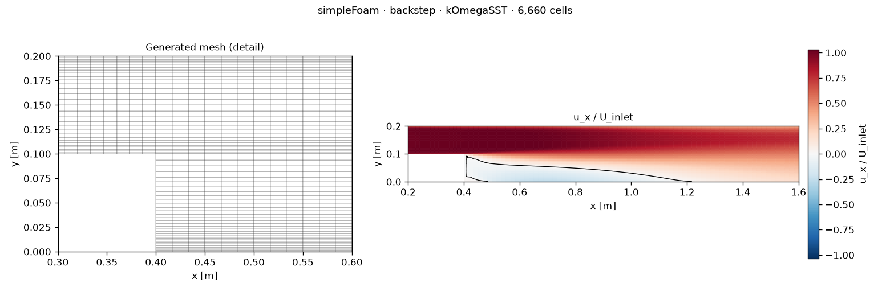
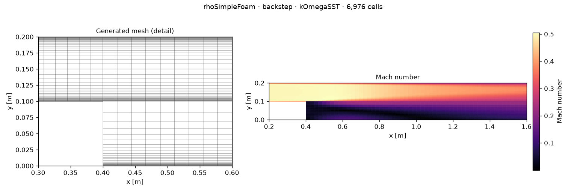
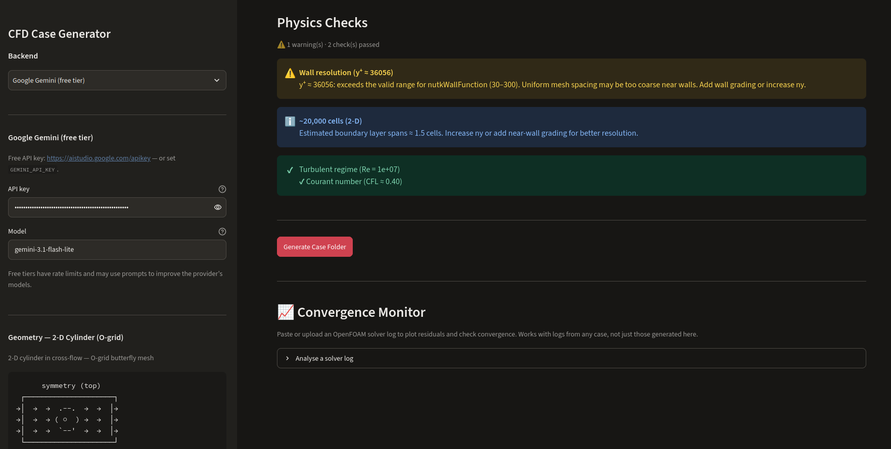
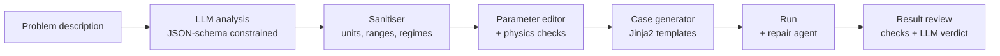

# CFD Case Generator

[](../../actions/workflows/tests.yml)

Describe a fluid-dynamics problem in plain English and get a complete, **ready-to-run
OpenFOAM case**. An LLM interprets the description; tested code turns it into the mesh,
boundary conditions, physics models and run scripts. The cases are **run, validated against
reference data and repaired automatically when they fail**.

<p align="center">
  <br>
  <em>"Laminar flow of water past a 2 cm circular cylinder at 7.5 mm/s (Re = 150). I want to see
  the von Kármán vortex street…" → pimpleFoam case with an O-grid mesh, run with <code>./Allrun</code></em>
</p>

## Results at a glance

| | |
|---|---|
| **Accuracy of the generated cases** | 5 benchmarks against analytical solutions and experiments: laminar flow, heat transfer and vortex shedding within **1.5 %**, turbulent separation (backward-facing step) within **5 %** — [report](docs/validation/results.md) |
| **LLM understanding, unseen descriptions** | free Gemini model: **100 %** fully correct setups; local 7B model: 40 % raw → **80 %** with the sanitiser — [evaluation](docs/evaluation/results.md) |
| **Description → judged result** | 30 descriptions run end to end with no human in the loop (Gemini answers, rule-based repairs, result reviewer): **25 trustworthy**, 8 of 10 on unseen descriptions — [benchmark](docs/evaluation/e2e_results.md) |
| **Run-and-fix agent** | 10 injected faults: rules alone repair **6**, rules + Gemini repair **10** — [benchmark](docs/evaluation/agent_results.md) |
| **Tested in OpenFOAM** | 39 generated cases (5 solvers × 9 geometries × 4 flow models, plus imported meshes including a real SALOME export) meshed and run in CI on every push |

## What it does

- **Understands the problem.** Claude, free cloud models (Gemini, Groq) or local models
  (Ollama) choose solver, fluid, boundary conditions, flow model and geometry, constrained by a
  JSON schema. A **sanitiser** then fixes what models get wrong (units, Reynolds and Mach
  regimes, solver/geometry conflicts) and shows every correction.
- **Generates complete OpenFOAM cases:** 5 solvers (steady/transient incompressible,
  compressible, natural convection, free surface), 9 meshed geometries plus STL import,
  laminar or RANS, wall-graded meshes, serial or parallel runs.
- **Uses your own geometry:** import a mesh made in **SALOME** (.unv). Its boundary groups,
  even with names like *Entrée* or *Paroi*, are mapped to inlet/outlet/wall roles by the LLM.
  You can correct the mapping, and inlet velocities follow each inlet's actual orientation.
- **Checks the physics before running:** Reynolds and Mach regime, y⁺, Courant number, mesh
  resolution.
- **Runs and repairs:** a run-and-fix agent diagnoses failures from the OpenFOAM logs and
  repairs them, with rule-based fixes first and an LLM for the rest. It works from the command
  line, or from the web app's *Run in OpenFOAM* panel, which shows each step live with the
  residuals and the flow field. Strict safety rails
  apply: no code execution and no edits to run scripts.
- **Judges the result:** after a run, a result reviewer checks that the simulation matches the
  request (speed, Re, Mach), converged, conserves mass, has a suitable wall y⁺ and sane fields,
  and gives a verdict (trustworthy, questionable or unreliable). An LLM can explain the
  verdict and suggest improvements. `cfdgen review case/ --backend gemini`
- **Proves the results:** validation benchmarks, an LLM evaluation with a held-out set, and a
  fault-injection benchmark, all reproducible from the repo.

## Gallery

Each image comes from a case generated from the quoted description, run in OpenFOAM and drawn
cell by cell from the results ([inputs](examples), [script](scripts/make_gallery.py)).

| | |
|:-:|:-:|
| <br>**Dam break**, interFoam (VOF)<br><sub>"A column of water 0.36 m wide and 0.3 m high collapses under gravity into a dry tank…"</sub> | <br>**Backward-facing step**, simpleFoam + k-ω SST<br><sub>"Turbulent air flow at 10 m/s over a backward-facing step 10 cm high…"; black line: edge of the recirculation zone</sub> |
| <br>**Mach 0.5 flow over a step**, rhoSimpleFoam + k-ω SST<br><sub>"Compressible air flow at 170 m/s (Mach 0.5)… over a backward-facing step"; converged, judged trustworthy by the result reviewer</sub> | <br>**T-junction**, simpleFoam + k-ε<br><sub>"Water at 0.5 m/s… meets a side branch"; the merged stream doubles in speed</sub> |

<p align="center"><br>
<sub>Validation: vortex-shedding frequency of a generated cylinder case vs. Williamson's experimental correlation (+1.4 %)</sub></p>

## The web app

<p align="center"></p>

<details>
<summary><b>More screenshots</b>: boundary conditions and automatic corrections, physics checks</summary>
<p align="center">
  <br><br>
  
</p>
</details>

## Quick start

```bash
git clone <this repo> && cd cfd-case-generator
python -m venv .venv && source .venv/bin/activate
pip install -r requirements.txt && pip install -e .

streamlit run app/main.py                       # web app at http://localhost:8501
```

Command line, with [OpenFOAM](https://www.openfoam.com) v1912+ sourced to run cases:

```bash
export GEMINI_API_KEY="…"                       # free key: aistudio.google.com/apikey
cfdgen describe "Laminar flow past a cylinder at Re = 100" -o cylinder/ --backend gemini --fix gemini
cfdgen generate examples/dam_break.json -o dambreak/ --run      # no LLM or key needed
```

No key at all? Use a local model with `--backend ollama` (see [LLM backends](docs/GUIDE.md#llm-backends)).

## How it works



## Documentation

- **[Guide](docs/GUIDE.md):** supported cases, how it works in detail, LLM backends, running
  cases, the agent and its safety rails, testing, project structure, known limitations
- **[Validation report](docs/validation/results.md):** benchmarks with plots
- **[LLM evaluation](docs/evaluation/results.md):** per-model and per-case results, dev and held-out sets
- **[End-to-end benchmark](docs/evaluation/e2e_results.md):** every description generated, run and judged
- **[Agent benchmark](docs/evaluation/agent_results.md):** fault-by-fault repair results

## License

[MIT](LICENSE)
