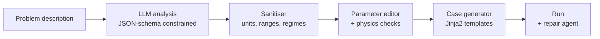

# CFD Case Generator — Guide

The [README](../README.md) gives the overview. This guide covers everything in detail.

- [Supported cases](#supported-cases)
- [How it works](#how-it-works)
- [LLM backends](#llm-backends)
- [Your own geometry: SALOME mesh import](#your-own-geometry-salome-mesh-import)
- [Running a generated case](#running-a-generated-case)
- [Run-and-fix agent](#run-and-fix-agent)
- [Validation](#validation)
- [LLM evaluation](#llm-evaluation)
- [Examples and gallery](#examples-and-gallery)
- [Testing](#testing)
- [Project structure](#project-structure)
- [Known limitations](#known-limitations)

---

## Supported cases

Target: **OpenFOAM v1912** (ESI, openfoam.com), including the Debian/Ubuntu `openfoam` package.

| Solver | Physics | Geometries |
|---|---|---|
| `simpleFoam` | Steady incompressible | channel, T-junction, rectangular obstacle, backward-facing step, cylinder (O-grid), pipe (axisymmetric wedge), airfoil (C/H-grid), STL import (snappyHexMesh) |
| `pimpleFoam` | Transient incompressible | same as simpleFoam |
| `rhoSimpleFoam` | Steady compressible (Ma > 0.3) | same as simpleFoam |
| `buoyantSimpleFoam` | Steady natural convection | differentially heated cavity |
| `interFoam` | Two-phase free surface (VOF) | dam break |

Flow models: `laminar`, or RANS with `kEpsilon`, `kOmegaSST` or `SpalartAllmaras` (interFoam is
laminar).

### Verified in OpenFOAM

`tests/test_openfoam_integration.py` generates each case below and runs its own `Allrun`
script. It checks that `blockMesh` / `snappyHexMesh` succeed, `checkMesh` reports
*Mesh OK*, no faces are left unassigned, and the solver runs and exits without NaNs.

| | channel/cavity/dambreak | t_junction | rect. obstacle | backstep | cylinder | pipe | airfoil | STL |
|---|:-:|:-:|:-:|:-:|:-:|:-:|:-:|:-:|
| simpleFoam (laminar + 3 RANS models) | ✅ | ✅ | ✅ | ✅ | ✅ | ✅ | ✅ | ✅ |
| pimpleFoam (laminar + 3 RANS models) | ✅ | ✅ | ✅ | ✅ | ✅ | ✅ | ✅ | |
| rhoSimpleFoam (laminar + 3 RANS models) | ✅ | ✅ | ✅ | ✅ | ✅ | ✅ | ✅ | |
| buoyantSimpleFoam (laminar + 3 RANS models) | ✅ | | | | | | | |
| interFoam | ✅ | | | | | | | |
| parallel run (decomposePar → mpirun → reconstructPar) | ✅ | | | | | | | |

These are short smoke runs (30 iterations or 15 time steps): they show that a case meshes,
starts and stays numerically stable. Accuracy is checked by the [validation](#validation)
benchmarks, which run to convergence.

---

## How it works



1. **Structured analysis.** The model must answer with an object matching
   [`app/schema.py`](../app/schema.py), enforced by structured outputs. The response is
   never free-form text that needs parsing.
2. **Sanitising.** [`app/sanitize.py`](../app/sanitize.py) checks what a schema cannot, and
   shows the user every correction:
   - viscosities in the wrong units, implausible temperatures or speeds
   - solver/geometry conflicts; a cavity or dam-break geometry decides the solver, and a
     natural-convection solver with an inlet velocity becomes simpleFoam
   - geometry that does not fit its domain
   - inlet velocities that do not point into the domain
   - a Reynolds number that disagrees with U·L/ν: a value stated in the description wins and
     the velocity is rescaled; otherwise Re is recomputed from the velocity
   - a Mach number stated in the description sets the velocity; above Ma ≈ 0.3 the
     compressible rhoSimpleFoam is used
   - laminar vs RANS where Re leaves no doubt (laminar below 1 000, k-ω SST above 10 000)
   - a steady solver for a bluff body above the vortex-shedding threshold (switched to the
     transient pimpleFoam)

   Most of these rules came from the [LLM evaluation](#llm-evaluation), which exposed
   systematic mistakes of real models.
3. **Review.** The web app shows the analysis and runs physics checks: Reynolds and Mach
   regime, y⁺ of the generated (wall-graded) mesh, Courant number, mesh resolution. Inlet
   speed, viscosity, flow model, mesh resolution and core count can be overridden.
4. **Generation.** Solver-specific generators in [`app/generators/`](../app/generators)
   compute derived quantities and render the templates in [`templates/`](../templates):
   turbulence inlet values, wall-graded block meshes (growth rate ≤ 1.2; the cylinder adds
   radial cells until the wall cell reaches the wall-function target), time steps from wave
   or Courant limits, run lengths long enough for vortex shedding, and the hierarchical
   decomposition for parallel runs.
5. **Run and repair.** The [run-and-fix agent](#run-and-fix-agent) runs the case and repairs
   it if it fails.

---

## LLM backends

| Backend | Key | Default model | Notes |
|---|---|---|---|
| **Claude** | `ANTHROPIC_API_KEY` ([console.anthropic.com](https://console.anthropic.com)) | `claude-opus-5-5` | Override with `CFD_CLAUDE_MODEL`. Declined requests are retried server-side on a fallback model. |
| **Google Gemini** (free tier) | `GEMINI_API_KEY` ([aistudio.google.com/apikey](https://aistudio.google.com/apikey)) | `gemini-3.1-flash-lite` | Less busy than `gemini-3.8-flash`; 100 % in the [evaluation](#llm-evaluation). |
| **Groq** (free tier) | `GROQ_API_KEY` ([console.groq.com/keys](https://console.groq.com/keys)) | `llama-3.3-70b-versatile` | |
| **OpenRouter** | `OPENROUTER_API_KEY` ([openrouter.ai/keys](https://openrouter.ai/keys)) | — | Choose a `:free` model with `--model`. |
| **Ollama** (local, no key) | — | `qwen2.5:7b` | Install [Ollama](https://ollama.com) ≥ 0.5, `ollama pull qwen2.5:7b`. Override with `CFD_OLLAMA_MODEL`. |
| Any OpenAI-compatible server (LM Studio, vLLM, …) | `OPENAI_COMPAT_API_KEY` | `--model` | `--base-url`, default `http://localhost:1234/v1` |

Pick the backend in the web app's sidebar, or with `--backend` on the command line:

```bash
export GEMINI_API_KEY="…"
cfdgen describe "Laminar flow past a cylinder at Re = 100" -o cylinder/ --backend gemini --run
```

- Every backend gets the same JSON schema. Providers without strict JSON-schema support fall
  back to JSON mode with the schema in the prompt.
- Free tiers can be busy (HTTP 503) or rate-limited (429): requests are retried after
  5/15/30 s. A cloud request waits up to 300 s (`--timeout`, `CFD_LLM_TIMEOUT`).
- If a model is still unavailable (or retired), the next model in the provider's fallback list
  answers, and the app says so. Gemini: `gemini-3.1-flash-lite` → `gemini-3.8-flash` →
  `gemini-3-flash-preview`; Groq: `llama-3.3-70b-versatile` → `llama-3.1-8b-instant`. Override
  with `GEMINI_FALLBACK_MODELS` / `GROQ_FALLBACK_MODELS` (comma-separated; empty disables).
  The evaluations disable fallback so that scores belong to the named model.
- Providers rename free models often. If a model no longer exists, the error lists the text
  models the provider currently offers, newest first. Set `GEMINI_MODEL` / `GROQ_MODEL` /
  `OPENROUTER_MODEL` to change the default.
- Free tiers may use prompts to improve the provider's models.
- Small local models make more mistakes (see the [evaluation](#llm-evaluation)); the
  sanitiser catches many, but review the analysis before running.

---

## Your own geometry: SALOME mesh import

Mesh any geometry in [SALOME](https://www.salome-platform.org) and use it instead of a built-in
geometry ([`app/mesh_import.py`](../app/mesh_import.py)).

**In SALOME:**
1. Build the geometry and a **3-D volume mesh** (e.g. NETGEN, with viscous layers if needed).
2. Create a **group of faces for every boundary** (Mesh → Create Group, type *Face*) and name
   it: `inlet`, `outlet`, `walls`, `entree`, `paroi`, `farfield`, … Faces in no group end up
   in a `defaultFaces` patch.
3. For a 2-D case, mesh a slab one cell thick and put its two flat sides in a group such as
   `frontAndBack` (role *empty*).
4. Export: *File → Export → UNV*.

**In the app:**
- **Web app:** open *🧩 Import a SALOME mesh*, upload the `.unv`, describe the flow and click
  *Analyse*. A table shows the role chosen for each group; change any wrong role before
  generating.
- **Command line:**
  ```bash
  cfdgen describe "Air at 5 m/s through this duct" --mesh duct.unv -o duct/ --backend gemini --run
  cfdgen generate analysis.json --mesh duct.unv --role Inflow=inlet -o duct/   # no LLM: names decide
  ```

**What happens:**
1. **Conversion.** OpenFOAM's `ideasUnvToFoam` converts the mesh, and each group becomes a
   patch.
2. **Role mapping.** The LLM maps each patch to a role from its name, size and orientation and
   from your description: `inlet`, `outlet`, `wall`, `symmetry`, `empty`, `hot_wall` or
   `cold_wall`. Without an LLM, a keyword heuristic (English and French) decides. Every
   difference between the two is reported.
3. **Patch types.** These are set from the roles (`wall`, `symmetryPlane`, `empty`).
4. **Inlet direction.** Each inlet blows along its inward normal, so ducts need not point
   along x.
5. **Case and checks.** The case uses the imported mesh (`Allrun` skips `blockMesh`). Mesh
   quality is checked by `checkMesh` when the case runs, not estimated beforehand.

**Real SALOME export:** [`examples/meshes/box_duct_salome.unv`](../examples/meshes/box_duct_salome.unv)
was produced by SALOME 9.16 itself: a NETGEN tetrahedral mesh of a box duct with groups
`entree`, `sortie` and `parois`, scripted without the GUI by
[`scripts/salome_box_duct.py`](../scripts/salome_box_duct.py). It imports, passes `checkMesh`,
converges in 181 iterations and conserves mass to 0.3 %.

**Example:** [`examples/meshes/l_duct.unv`](../examples/meshes/l_duct.unv) is an L-shaped duct
(4 608 cells) with groups `Entree`, `Sortie` and `Parois`. It is written by
[`scripts/make_sample_unv.py`](../scripts/make_sample_unv.py) in the format SALOME exports. It
runs in CI as part of the core OpenFOAM suite. In a k-ω SST run, the outflow matches the inflow
to 0.1 %.

**Not supported yet:** free-surface (interFoam) cases on imported meshes, and SALOME's MED
format (export UNV instead).

---

## Running a generated case

```bash
source /usr/share/openfoam/etc/bashrc 2>/dev/null   # or your installation's etc/bashrc
cd my_case/
./Allrun                                  # writes log.blockMesh, log.<solver>, …
touch case.foam && paraview --no-mpi case.foam
./Allclean
```

- `Allrun` works without OpenFOAM's `RunFunctions`, which the Debian/Ubuntu package does not
  ship.
- With the Debian/Ubuntu `paraview` package, ParaView can hang silently at startup while
  initialising MPI; `--no-mpi` avoids it (or add `alias paraview='paraview --no-mpi'` to
  `~/.bashrc`).
- Paste `log.<solver>` into the web app's **Convergence Monitor** to plot residuals.

Command line:

```bash
cfdgen describe "Laminar flow past a 2-D cylinder at Re = 100" -o cylinder/ --run   # LLM
cfdgen generate examples/dam_break.json -o dambreak/ --run    # from an analysis JSON, no LLM
cfdgen check examples/backward_facing_step.json               # physics checks only
```

---

## Run-and-fix agent

[`app/agent.py`](../app/agent.py) runs a case. If it fails, it diagnoses the failure from the
OpenFOAM logs (missing entry, divergence, patch mismatch, syntax error, …), fixes it and
reruns, up to 3 times:

1. **Rules** for failures with a known remedy: a missing `…Final` or `pcorr` solver entry, a
   missing divergence scheme, divergence (stronger under-relaxation with α_p ≈ 1 − α_U and
   SIMPLEC off, pressure limits for compressible flow, or a smaller Courant number for
   transient runs). A rule is tried once per kind of failure (twice for divergence); if the
   failure persists, the LLM gets the next attempt.
2. **An LLM** for the rest: it gets the error, the end of the log and the relevant
   dictionaries, and returns one corrected file. Near-miss paths (`0/fvSchemes`) are mapped
   onto the files it was shown (`system/fvSchemes`).

**Safety rails** (tested in `tests_extended/test_agent.py`): the LLM may only rewrite existing
dictionaries in `system/`, `constant/` and `0/`, never `Allrun` or the mesh. Content with
code-execution directives (`#codeStream`, `#calc`, `coded…` conditions, `systemCall`) is
rejected, because OpenFOAM can compile and run C++ written in a dictionary. A "fix" that
changes `endTime` is rejected too. Every attempt is logged with a diff in `agent_report.md`.

**In the web app:** after *Generate Case Folder*, open **▶ Run in OpenFOAM**. Choose a quick
check (about 60 iterations or 15 time steps) or a full run, and whether the LLM selected in the
sidebar may fix what the rules cannot. The agent's steps appear live; afterwards the panel
shows the agent report with diffs, the residuals, the velocity field and a download of the
case as run. The panel needs the app to be started from a terminal where OpenFOAM is sourced.

**From the command line:**

```bash
cfdgen generate examples/dam_break.json -o dambreak/ --fix gemini   # run, repair if needed
cfdgen fix my_case/ --backend gemini                                # repair an existing case
cfdgen fix my_case/                                                 # rules only, no LLM
```

**Fault-injection benchmark** ([`evals/faults.py`](../evals/faults.py)): 10 realistic faults,
mostly bugs this project actually had, are injected into working cases.

| Repair mode | Faults repaired |
|---|---:|
| Rules only | 6 / 10 |
| Rules + `qwen2.5:7b` (local) | 8 / 10 |
| **Rules + `gemini-3.1-flash-lite`** | **10 / 10** |

Per fault: [`docs/evaluation/agent_results.md`](evaluation/agent_results.md). qwen was at 7/10
before near-miss paths were mapped: it often had the right diagnosis but the wrong path.

```bash
python -m evals.faults --check                                 # each fault breaks its case
python -m evals.faults --mode rules
python -m evals.faults --mode both --backend gemini --model gemini-3.1-flash-lite
```

---

## Validation

[`validation/`](../validation) generates each benchmark through the same code path as the app,
runs it in OpenFOAM to convergence and compares it with reference data. Post-processing is
done in Python by [`app/postprocess`](../app/postprocess) because OpenFOAM's function objects
crash with an `IOstream "sha1"` error in the v1912 Debian build.

| Benchmark | Quantity | Reference | Error |
|---|---|---|---:|
| Plane Poiseuille flow, Re = 100 | centreline velocity, pressure gradient, profile | analytical | ≤ 0.14 % |
| Hagen–Poiseuille pipe (axisymmetric), Re = 100 | centreline velocity, pressure gradient, profile | analytical | ≤ 0.18 % |
| Natural convection cavity, Ra = 10⁵ | Nusselt number, u_max, v_max | de Vahl Davis (1983) | ≤ 0.33 % |
| Vortex shedding behind a cylinder, Re = 100 | Strouhal number | Williamson (1996) | +1.4 % |
| Turbulent backward-facing step, Re_H = 37 400 (k-ω SST) | reattachment length x_r / H | Driver & Seegmiller (1985) experiment | −4.8 % |

The cylinder's St is expected to be slightly high: symmetry planes 10 D from the cylinder
(5 % blockage) speed up the shedding compared with the unbounded reference. The step's 5.96 vs. the measured 6.26 is typical of RANS models, which predict
separation less precisely; refining the mesh from 23 600 to 42 100 cells changes it by only
1.3 %, so the deviation comes from the turbulence model, not the mesh. All four results
are identical on a laptop (6 cores) and on GitHub's CI runners (2 cores). Full report with
plots: [`docs/validation/results.md`](validation/results.md).

```bash
source /usr/share/openfoam/etc/bashrc
python -m validation.run          # ≈ 13 min on 6 cores; writes docs/validation/
```

---

## LLM evaluation

[`evals/`](../evals) scores how often a model turns a description into the *right* CFD setup:
solver, geometry, laminar vs RANS, steady vs transient, the Reynolds number actually simulated
(U·L/ν within 15 %) and the fluid. Each answer is scored raw and after the sanitiser, i.e. what
the app actually generates.

| Model | Held-out: raw | **Held-out: after sanitiser** | Dev set: after sanitiser | Time per answer |
|---|---:|---:|---:|---:|
| `gemini-3.1-flash-lite` (free cloud tier) | 100 % | **100 %** | 100 % | 3 s |
| `qwen2.5:7b` (local) | 40 % | **80 %** | 80 % | 65 s |
| `mistral` 7B (local) | 40 % | **60 %** | 70 % | 83 s |
| `llama3.1:8b` (local) | 20 % | **40 %** | 60 % | 65 s |

- The 20 **development** cases ([`evals/cases.json`](../evals/cases.json)) exposed systematic
  mistakes that the sanitiser now repairs: laminar flow at Re = 13 million, turbulence models at
  Re = 40, an incompressible solver at Mach 0.73, 0.82 m/s for "Mach 0.8", and the sanitiser
  itself breaking correct geometries when the solver was wrong.
- The 10 **held-out** cases ([`evals/cases_holdout.json`](../evals/cases_holdout.json)) were
  written after those rules and committed before any model saw them, so they give the unbiased
  numbers. The sanitiser was not changed after seeing them.
- Not fixed on purpose: local models misread dam-break descriptions (they used gravity as an
  inlet velocity). Catching that would need keyword rules fitted to the test sentences.

Per-case results: [`docs/evaluation/results.md`](evaluation/results.md).

```bash
python -m evals.run --backend ollama --model qwen2.5:7b      # answers are cached in evals/responses/
python -m evals.run --backend gemini --model gemini-3.1-flash-lite --delay 6
python -m evals.run --report                                 # re-score cached answers
```

---

## Examples and gallery

Each file in [`examples/`](../examples) holds a description and the matching analysis, written by
hand in the LLM's output format, so cases can be generated without an API key
(`cfdgen generate examples/<name>.json`). [`scripts/make_gallery.py`](../scripts/make_gallery.py)
runs them in OpenFOAM and renders [`docs/gallery/`](gallery) cell by cell from the results.

---

## Testing

The default suite is kept small: the OpenFOAM runs plus one fast regression test per bug found.

```bash
pip install -r requirements-dev.txt
source /usr/share/openfoam/etc/bashrc
pytest                                  # core: 39 OpenFOAM cases + regression tests (~2 min)
pytest -m benchmark -v                  # validation against reference data (~12 min)
pytest tests_extended                   # generators, LLM, sanitiser, UI, CLI, agent, … (~25 s)
```

| Suite | What it covers |
|---|---|
| `tests/test_openfoam_integration.py` | 39 generated cases (incl. two on imported meshes, one a real SALOME export) meshed and run in OpenFOAM (skipped without OpenFOAM) |
| `tests/test_regressions.py` | One test per bug found by the OpenFOAM runs; no OpenFOAM needed |
| `tests/test_benchmarks.py` | Validation benchmarks within tolerance (opt-in) |
| `tests_extended/` | Template rendering, grading maths, sanitiser, LLM requests (mocked), headless Streamlit UI, CLI, post-processing reader, agent diagnosis and safety rails, evaluation scoring |

CI ([`.github/workflows/tests.yml`](../.github/workflows/tests.yml)) runs the core and extended
suites on Python 3.10 and 3.12; the OpenFOAM suite and the validation benchmarks run on Ubuntu
with the distribution's `openfoam` package, and the validation report is uploaded as an
artifact.

---

## Project structure

```
app/
├── main.py                 # Streamlit entry point (composes app/ui/*)
├── cli.py                  # cfdgen command-line interface
├── ui/                     # sidebar, problem input, analysis view, parameter editor,
│                           # physics checks, case output, convergence monitor
├── llm.py                  # Claude, Ollama and OpenAI-compatible backends (structured outputs)
├── schema.py               # JSON schema the LLM must follow
├── sanitize.py             # unit / range / regime / compatibility repair of the analysis
├── agent.py                # run-and-fix agent
├── mesh_import.py          # SALOME (.unv) mesh import and boundary-role mapping
├── editor.py               # parameter-editor overrides → analysis
├── validation.py           # physics checks (Re, Ma, y+, CFL, resolution)
├── generators/             # one generator per solver + shared base (meshing maths)
├── postprocess/            # pure-Python OpenFOAM mesh/field reader + 2-D renderer
├── log_parser.py           # residual extraction from solver logs
├── stl_parser.py           # STL bounding box for snappyHexMesh background meshes
└── geometry_sketches.py    # ASCII sketches shown in the sidebar
templates/
├── <solver>/               # 0/, constant/, system/ Jinja2 templates per solver
├── geometries/<name>/      # blockMeshDict per geometry
├── _macros/                # boundary-condition macros shared by all field files
└── _shared/                # Allrun/Allclean, decomposeParDict, snappyHexMesh, sampling
validation/                 # benchmark definitions + runner (python -m validation.run)
evals/                      # LLM evaluation (run.py) and agent fault benchmark (faults.py)
examples/                   # problem descriptions with their analyses
scripts/make_gallery.py     # runs the examples and renders docs/gallery/
scripts/make_sample_unv.py  # writes the sample mesh examples/meshes/l_duct.unv
scripts/salome_box_duct.py  # SALOME script that produced examples/meshes/box_duct_salome.unv
docs/                       # this guide, gallery, screenshots, validation and evaluation reports
tests/                      # core tests (fixtures.py: shared analyses)
tests_extended/             # extended tests, run manually
```

---

## Known limitations

- **OpenFOAM flavour.** Templates target ESI OpenFOAM (v1912+). OpenFOAM.org (v10+ uses
  `physicalProperties`, different solver names) is not supported.
- **Results are a starting point.** Meshes are coarse 2-D (one cell thick) or axisymmetric.
  For production use, check mesh independence and y⁺, and validate against reference data.
- **Turbulence modelling.** Laminar or RANS (`kEpsilon`, `kOmegaSST`, `SpalartAllmaras`) with
  wall functions; no LES/DES and no low-Re wall resolution. Only the cylinder mesh sizes its
  wall cells for the wall-function target; at very high Re the other geometries' first cell
  can exceed y⁺ ≈ 300 (the y⁺ check reports this; increase the mesh refinement).
- **Validation coverage.** Laminar steady and unsteady flow, natural convection and one
  turbulent (RANS) separated flow. No compressible or free-surface benchmark yet.
- **Boundary conditions.** Uniform inflow, zero-gradient / fixed-pressure outlets and no-slip
  walls. Turbulent inflow profiles and mapped BCs are not generated.
- **Airfoil geometry.** A rectangular-section body of the requested chord and thickness on a
  coarse far-field mesh, not a true NACA profile. Import a SALOME mesh or an STL for an exact
  shape.
- **Imported meshes.** UNV only (not MED), no free-surface cases, and no automatic y⁺/resolution
  estimate (checkMesh runs instead).
- **Radiation** is off in `buoyantSimpleFoam` (`radiationProperties` → `none`).
- **Local LLMs** misread some descriptions (free-surface flows especially); use a cloud model
  or review the analysis.
