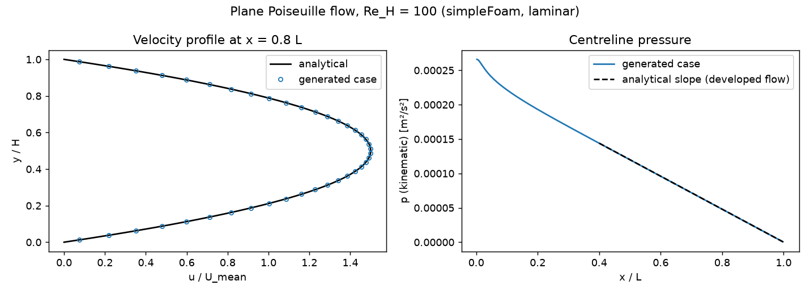
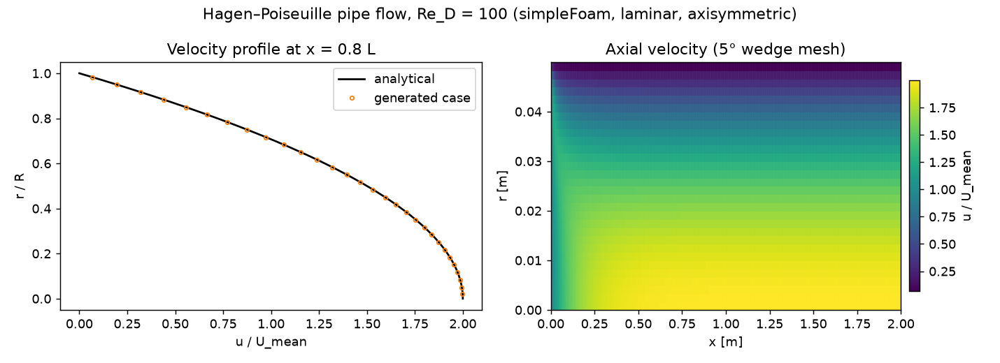
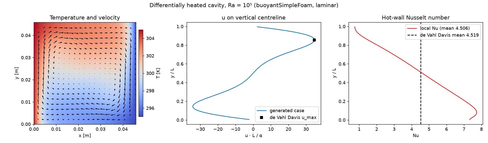

# Validation results

Generated by `python -m validation.run` (OpenFOAM v1912). Each case is produced by the
normal generator from the analysis an LLM would return for the description below, run
with its own `Allrun`, and post-processed in Python (`app/postprocess`).

| Benchmark | Quantity | Generated case | Reference | Error | Tolerance | |
|---|---|---:|---:|---:|---:|:-:|
| Plane Poiseuille flow (laminar channel) | Centreline velocity u_max / U_mean | 1.498 | 1.5 | -0.14 % | ±1 % | ✅ |
| Plane Poiseuille flow (laminar channel) | Pressure gradient dp/dx | -0.0001199 | -0.00012 | -0.08 % | ±2 % | ✅ |
| Plane Poiseuille flow (laminar channel) | Profile: 1 + max deviation from exact / u_max | 1.001 | 1 | +0.08 % | ±1 % | ✅ |
| Hagen–Poiseuille flow (laminar pipe, axisymmetric) | Centreline velocity u_max / U_mean | 1.997 | 2 | -0.16 % | ±1 % | ✅ |
| Hagen–Poiseuille flow (laminar pipe, axisymmetric) | Pressure gradient dp/dx | -0.0003205 | -0.00032 | +0.15 % | ±2 % | ✅ |
| Hagen–Poiseuille flow (laminar pipe, axisymmetric) | Profile: 1 + max deviation from exact / u_max | 1.002 | 1 | +0.18 % | ±1.5 % | ✅ |
| Natural convection in a square cavity, Ra = 10⁵ | Average Nusselt number (hot wall) | 4.506 | 4.519 | -0.30 % | ±3 % | ✅ |
| Natural convection in a square cavity, Ra = 10⁵ | Max u on vertical centreline · L/α | 34.84 | 34.73 | +0.33 % | ±5 % | ✅ |
| Natural convection in a square cavity, Ra = 10⁵ | Max v on horizontal centreline · L/α | 68.57 | 68.59 | -0.03 % | ±5 % | ✅ |

## Plane Poiseuille flow (laminar channel)

> Laminar flow of a fluid with ν = 1e-5 m²/s between two parallel plates 0.1 m apart, 2 m long, mean velocity 0.01 m/s (Re = 100).

- **Solver:** `simpleFoam` · **cells:** 8,000 · **run time:** 3 s · converged in 197 iterations
- **Reference:** Analytical: u(y) = 6·U·(y/H)(1 − y/H), dp/dx = −12 ν U / H²

## Hagen–Poiseuille flow (laminar pipe, axisymmetric)

> Laminar flow in a circular pipe of radius 5 cm and length 2 m, mean velocity 0.01 m/s, ν = 1e-5 m²/s (Re_D = 100).

- **Solver:** `simpleFoam` · **cells:** 9,000 · **run time:** 95 s
- **Reference:** Analytical: u(r) = 2·U·(1 − r²/R²), dp/dx = −8 ν U / R²

## Natural convection in a square cavity, Ra = 10⁵

> Natural convection of air in a square cavity of side 4.59 cm, hot left wall at 305 K, cold right wall at 295 K, adiabatic top and bottom (Ra = 1e5). Steady state, laminar.

- **Solver:** `buoyantSimpleFoam` · **cells:** 10,000 · **run time:** 104 s · converged in 8936 iterations
- **Reference:** de Vahl Davis, Int. J. Numer. Meth. Fluids 3 (1983) 249–264
- **Notes:** Compressible perfect-gas solver with ΔT = 10 K (≈ Boussinesq); uniform 100 × 100 mesh; the reference is a Boussinesq solution at Pr = 0.71 (case: Pr = 0.713).

